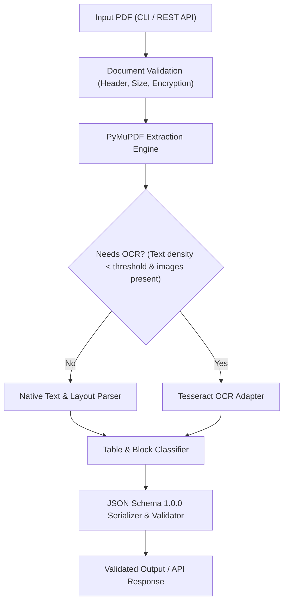

# Document Intelligence OCR Pipeline

A modular Python pipeline that ingests PDF documents, detects layout elements, extracts native text or triggers OCR when necessary, and emits a structured, versioned JSON document schema.

Status: Pre-release / Portfolio evaluation (v0.1.0).

---

## Key Capabilities

- **Hybrid Extraction Flow**: Extracts native digital text directly via PyMuPDF; automatically identifies scanned pages and routes them to OCR.
- **Layout & Structure Preservation**: Identifies document metadata, page boundaries, headings (via font size and length heuristics), paragraphs, and tabular structures.
- **Bounding Box Coordinates**: Emits normalized coordinates `[x0, y0, x1, y1]` for spatial traceability back to source pages.
- **Safe Boundary Handling**: Rejects encrypted, corrupt, empty, and oversized documents with typed HTTP and CLI error messages.
- **Synchronous REST API & CLI**: Exposes standard endpoints (`/health`, `/v1/documents`, `/v1/schema`) and CLI subcommands (`process`, `validate`, `batch`).
- **Deterministic Offline Testing**: Integrates pluggable OCR adapters (`TesseractOcrEngine` and `FakeOcrEngine`) for isolated local test execution without external binary dependencies.

---

## Architecture Overview



---

## Repository Structure

```text
document-intelligence-ocr-pipeline/
├── .github/
│   └── workflows/
│       └── ci.yml
├── src/
│   └── docintel/
│       ├── __init__.py
│       ├── api.py           # FastAPI application
│       ├── cli.py           # Typer CLI application
│       ├── config.py        # Environment settings
│       ├── exceptions.py    # Typed domain exceptions
│       ├── extractor.py     # PDF parsing & layout detection
│       ├── models.py        # Pydantic v2 JSON Schema 1.0.0
│       ├── ocr.py           # Pluggable OCR engines
│       └── pipeline.py      # Core orchestration & batch runner
├── tests/
│   ├── conftest.py          # Synthetic PDF fixtures
│   ├── test_api.py          # REST endpoint tests
│   ├── test_cli.py          # CLI command tests
│   ├── test_extractor.py    # Extractor boundary tests
│   └── test_pipeline.py     # Batch and schema tests
├── .env.example
├── .gitignore
├── pyproject.toml
├── README.md
└── SECURITY.md
```

---

## Technology Choices

- **Python 3.11+**: Modern typed language baseline with fast runtime performance and broad wheel compatibility.
- **PyMuPDF (fitz)**: Chosen for high-throughput text rendering, layout extraction, and table identification.
- **Pillow & pytesseract**: Standard image rasterization and OCR interface, backed by an adapter protocol.
- **FastAPI & Pydantic v2**: High-performance HTTP transport with declarative validation and schema generation.
- **Typer**: Type-hinted CLI toolkit generating developer-friendly commands.
- **Ruff & Pytest**: Sub-second linting, formatting, and unit testing suite.

---

## Prerequisites

- Python 3.11 or newer (or `uv` package manager).
- Optional: Tesseract OCR binary (required only for live scanned-image OCR). If Tesseract is not installed, digital PDFs process normally, and scanned pages return an actionable warning.

---

## Installation & Setup

```bash
# Clone the repository
git clone https://github.com/baerozgaarmard/document-intelligence-ocr-pipeline.git
cd document-intelligence-ocr-pipeline

# Create virtual environment and install dependencies
uv venv --python 3.11 .venv
# On Windows:
.venv\Scripts\activate
# On Linux/macOS:
# source .venv/bin/activate

# Install package in editable mode with development dependencies
uv pip install -e ".[dev]"
```

---

## Configuration

Settings are loaded from environment variables:

| Variable | Description | Required | Default |
| --- | --- | --- | --- |
| `DOCINTEL_HOST` | API server bind host | No | `127.0.0.1` |
| `DOCINTEL_PORT` | API server port | No | `8000` |
| `DOCINTEL_MAX_UPLOAD_SIZE_BYTES` | Maximum allowed PDF size | No | `26214400` (25 MB) |
| `DOCINTEL_OCR_CHAR_THRESHOLD` | Min character count before triggering OCR | No | `50` |
| `DOCINTEL_OCR_DPI` | Rasterization resolution for OCR | No | `300` |
| `DOCINTEL_TESSERACT_CMD` | Explicit path to tesseract binary | No | Auto-detected from PATH |
| `DOCINTEL_STORAGE_DIR` | Local disk directory for document persistence | No | `./storage` |

---

## Running Locally

### 1. Launch the API Server

```bash
uvicorn docintel.api:app --host 127.0.0.1 --port 8000 --reload
```

Interactive API documentation will be available at `http://127.0.0.1:8000/docs`.

### 2. Run Single Document via CLI

```bash
docintel process path/to/sample.pdf --output output.json
```

### 3. Validate JSON Schema via CLI

```bash
docintel validate output.json
```

### 4. Run Batch Directory Processing

```bash
docintel batch path/to/input_folder --output-dir path/to/output_folder
```

---

## API Usage Examples

### Health Check

```bash
curl -s http://127.0.0.1:8000/health
```

Output:
```json
{"status": "ok", "version": "0.1.0"}
```

### Process PDF Document

```bash
curl -X POST "http://127.0.0.1:8000/v1/documents" \
  -H "accept: application/json" \
  -H "Content-Type: multipart/form-data" \
  -F "file=@sample.pdf"
```

### Retrieve Output Schema Contract

```bash
curl -s http://127.0.0.1:8000/v1/schema
```

---

## Output Contract Sample

```json
{
  "schema_version": "1.0.0",
  "document": {
    "document_id": "doc_a1b2c3d4",
    "filename": "specification.pdf",
    "page_count": 1,
    "metadata": {
      "title": "System Specification",
      "author": "Engineering Team",
      "created_at": "D:20261122120000",
      "producer": null
    }
  },
  "pages": [
    {
      "page_number": 1,
      "extraction_method": "native_text",
      "text": "Document Intelligence System Overview\n\nThis is an automated pipeline...",
      "blocks": [
        {
          "block_id": "p1-b0",
          "type": "heading",
          "text": "Document Intelligence System Overview",
          "bbox": {
            "x0": 50.0,
            "y0": 63.8,
            "x1": 360.5,
            "y1": 85.0
          },
          "confidence": 1.0,
          "font_size": 18.0
        }
      ],
      "tables": [],
      "warnings": [],
      "width": 595.0,
      "height": 842.0
    }
  ],
  "warnings": [],
  "processing": {
    "status": "completed",
    "duration_ms": 12.45,
    "pages_processed": 1,
    "ocr_page_count": 0
  }
}
```

---

## Testing & Quality Gates

Run all automated verification commands:

```bash
# 1. Run unit and integration tests
pytest -v

# 2. Check code style and formatting
ruff check .
ruff format --check .
```

---

## Security & Data Handling

- **Local Processing**: Ingestion, layout parsing, and OCR occur entirely on the local host. No document data is transmitted to external cloud APIs.
- **Bounded Resource Limits**: Maximum file size is strictly enforced before reading files into memory.
- **Malicious Payload Mitigation**: PDF header validation and exception wrapping prevent corrupted files from causing denial of service.

---

## Design Decisions & Trade-offs

1. **Adapter Pattern for OCR**: Real Tesseract binaries may not be present in every deployment or test container. Decoupling OCR via the `OcrEngine` protocol allows the core pipeline to remain testable in minimal CI runners.
2. **Synchronous Ingestion Baseline**: For documents under 25 MB, synchronous extraction is faster and avoids unnecessary dependencies like Celery or Redis. Batch processing provides non-blocking iteration for bulk folders.
3. **Pydantic Contract Enforcement**: Defining a versioned 1.0.0 contract allows downstream consumers to rely on stable field names and types.

---

## Known Limitations

- Rotated or skewed scans are not automatically deskewed in this release (Pillow rotation pre-processing is on the roadmap).
- Nested or borderless complex tables may fall back to paragraph blocks if standard line borders are missing.

---

## License

This project is licensed under the [MIT License](LICENSE).
